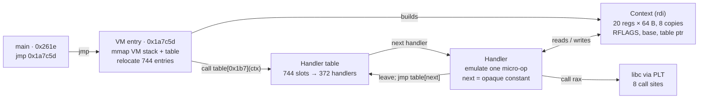

# Damnida — Write-up

**Category:** Reversing · **Flag:** `DH{NoM0reBytec0des}`

> Dreami studied obfuscation and built the **Damnida** obfuscator. Analyse a binary obfuscated with it and recover the flag.

## TL;DR

- `main`, `process` and `check` are hollowed out (`int3`); `main` jumps into a hidden 1.6 MB RWX segment that holds a VM.
- The VM has no bytecode. Each original instruction is split into micro-ops, and each micro-op is a native handler that tail-jumps to the next one through a 744-entry table, with operands and next indices hidden behind opaque constants.
- Instead of lifting 372 handlers, I emulated the binary with Unicorn and logged each handler's effect on the virtual registers and memory. That trace reads almost like the original assembly.
- `process()` is a 64-bit XTEA variant (decryption direction, shifts `<<8`/`>>10`, 16 rounds, key-derived delta). `check()` compares its output with a 16-byte constant.
- Running the constant through the inverse (encryption) gives the input: `NoM0reBytec0des`.

## Challenge

- `damnida`: ELF64 x86-64 PIE, dynamically linked, not stripped, 1,709,888 bytes, GCC 9.3.0 (Ubuntu 20.04).
- It prints `Input : `, reads a line, then prints `Wrong!` or `Correct !` followed by `DH{<input>}`. The flag is the accepted input wrapped in `DH{}`.

```
$ echo AAAA | ./damnida
Input : Wrong!
```

## Recon

The symbol table still names `main`, `process`, `check` and `test`, but three of the four bodies are gone.

| Symbol    | Address | Size (bytes) | Body                         |
| --------- | ------- | ------------ | ---------------------------- |
| `process` | 0x2199  | 401          | all `int3` (0xcc)            |
| `test`    | 0x232a  | 11           | real, an empty stub          |
| `check`   | 0x2335  | 745          | all `int3`                   |
| `main`    | 0x261e  | 982          | `jmp 0x1a7c5d`, then `int3`  |

The jump target lies outside every section. `readelf -l` shows why: a fifth LOAD segment that no section header covers.

```
LOAD  0x005000  0x000000000000d000  ...  0x19c000  0x19c000  RWE  0x1000
```

That segment is the VM: about 278,000 instructions of handler code, the handler table at `0x1a651d` and the VM entry at `0x1a7c5d`. Handlers contain no `syscall`; all I/O goes through the libc imports (`setvbuf`, `printf`, `read`, `strchrnul`, `puts`, `perror`).

## VM dispatch at a glance



The entry builds the context and calls the first handler. From then on, each handler performs one micro-op and jumps through the table to the next; libc calls are the only trips out to native code.

## VM internals

**Entry (`0x1a7c5d`):**

1. Saves the six argument registers.
2. Maps a 0x101000-byte VM stack and a copy of the handler table with raw `mmap` syscalls.
3. Finds the image base by walking back from its own RIP to a page-aligned `\x7fELF`.
4. Copies the 744-entry table from image offset `0x1a651d`, adding the base to every entry.
5. Sets VM `rbp` = `rsp` = stack + 0xfffc0, copies the argument registers in, and calls handler `0x1b7` with `rdi` = context.

**Context layout** (in the entry's frame, at `rbp-0x950`):

| Offset        | Contents |
| ------------- | -------- |
| 0x000–0x4ff   | 20 virtual registers, 64 bytes each: the value is stored 8 times and handlers read a random copy |
| 0x500–0x59f   | register remap table (slot = table[offset / 8]); identity in this build |
| 0x5a8         | virtual RFLAGS |
| 0x5b0         | VM stack base |
| 0x5b8         | relocated handler table |
| 0x5c0         | image base, for RIP-relative operands and PLT calls |
| 0x5e8         | scratch for opaque-constant arithmetic |
| 0x5f0         | mode flag, always 0; selects one arm of every opaque computation |

Register slots: 0 `rax`, 1 `rbx` (inferred), 2 `rdx`, 3 `rcx`, 4 `rsi`, 5 `rdi`, 6 `rbp`, 7 `rsp`, 8–15 `r8`–`r15`, 18 a scratch effective-address register (`EA` below).

**One handler.** Handler `0x1b7` emulates main's first instruction, `push rbp`. Simplified:

```c
// register operand: opaque, folds to 0x30 (rbp)
reg = (int32_t)((int64_t)(int32_t)0x90594a69 ^ 0x88a3a3eb24893707);
if (ctx->mode == 0) reg = (int32_t)(reg + 0x5ab4546f4b2f82c2);   // 0x30

REG(rsp) -= 8;
*(uint64_t *)REG(rsp) = REG(reg);

// next handler index: also opaque, folds to 0x169
next = 0x8877af46480284c1 + 0x34e8ad8b168aeb9d;
if (ctx->mode == 0) next += 0x429fa32ea172910b;                  // 0x169
leave; jmp ctx->table[next];   // rdi = ctx; table[0x169] = 0x11122e
```

- 744 table slots point at 372 distinct handler functions.
- One x86 instruction becomes several handlers: `mov eax, [rbp-0x29c]` is `EA ← rbp`, `EA ← EA − 0x29c`, `rax ← load32(EA)`.
- A libc call is one handler: it loads all 16 virtual GPRs into the real ones, `call`s the PLT stub and stores them back (8 such sites).
- Handlers end in `leave; jmp`, so the native stack never grows.

## Tracing

Lifting 372 handlers statically was not needed. Logging what each handler does to the virtual registers and to memory recovers the original code.

A first pass in gdb, with a breakpoint on every handler entry, gave the handler sequence (9,842 steps for a wrong input) but no memory effects. The second pass used [Unicorn](https://www.unicorn-engine.org/) (`pip install unicorn`), which runs the whole program in well under a second:

1. Map the five LOAD segments at `0x555555554000`.
2. Hook the PLT stubs (`0x2030 + 0x10·n`, names from `.rela.plt`) and emulate `setvbuf`, `printf`, `read`, `strchrnul`, `puts` and `perror`.
3. Hook `syscall` to serve the entry's `mmap` calls.
4. Map a page for FS so the stack-canary read at `fs:0x28` works, and point `stdin`/`stdout` at mapped memory.
5. Start at `main` (`0x261e`) and stop on a sentinel return address.

A block hook marks each handler entry; on the first one, `rdi` gives the context address. Memory hooks then sort every access:

- inside the context: a virtual register (offset / 64) or RFLAGS; other fields are dropped;
- inside the native stack or the handler table: handler locals and dispatch, dropped;
- anywhere else: a real VM memory access, logged with address, size and value.

Collapsing the 8 redundant copies of each register gives one line per handler: step, handler, registers read, memory touched, registers and flags written.

```
 8509 130e20 | rcx=addedbadaddedbad rax=d409bdd3e33babe0 |  | FL<-87 rax<-81e89981911a878d
 8513  24974 | rax=e73035a874c139c EA=7f00000ffd58 | R:M[7f00000ffd58]/8=0 W:M[7f00000ffd58]/8=f18cfca578b3ec64 | FL<-93
```

Dropping the pure `EA` arithmetic leaves something close to the original assembly. The step count was 9,842 for every wrong input tried (10,242 for the correct one), so counting instructions leaks nothing useful.

<details>
<summary><code>trace.py</code> — the Unicorn tracer (click to expand)</summary>

```python
#!/usr/bin/env python3
# Damnida VM tracer: one line per handler -> regs read | memory touched | regs/flags written
# usage: python3 trace.py ./damnida 'ABCDEFGH' > trace.txt
import struct, sys
from unicorn import *
from unicorn.x86_const import *

BIN, INPUT = sys.argv[1], sys.argv[2].encode() + b'\n'
data = open(BIN, 'rb').read()
BASE, STK, FS, LIBC = 0x555555554000, 0x7ff000000000, 0x7fe000000000, 0x7fd000000000
REGS = ['rax', 'rbx', 'rdx', 'rcx', 'rsi', 'rdi', 'rbp', 'rsp'] + \
       ['r%d' % i for i in range(8, 16)] + ['r16', 'r17', 'EA', 'r19']

mu = Uc(UC_ARCH_X86, UC_MODE_64)
mu.mem_map(BASE, 0x1aa000)
for off, va, size in [(0, 0, 0x1758), (0x2000, 0x2000, 0xa85), (0x3000, 0x3000, 0x1d8),
                      (0x3d88, 0x4d88, 0x288), (0x5000, 0xd000, 0x19c000)]:   # the 5 LOAD segments
    mu.mem_write(BASE + va, data[off:off + size])
for a in (STK, FS, LIBC):
    mu.mem_map(a, 0x100000 if a == STK else 0x1000)
mu.reg_write(UC_X86_REG_FS_BASE, FS)                        # stack canary at fs:0x28
mu.mem_write(BASE + 0x5010, struct.pack('<Q', LIBC + 0x100))   # stdout (copy reloc)
mu.mem_write(BASE + 0x5020, struct.pack('<Q', LIBC + 0x200))   # stdin: fileno at +0x70 reads 0
SENTINEL = LIBC + 0x800
mu.mem_write(SENTINEL, b'\xf4')

# PLT stub n is at 0x2030 + 0x10*n; names come from .rela.plt -> .dynsym -> .dynstr
plt = {}
for n in range(0xa8 // 24):
    info = struct.unpack_from('<Q', data, 0x16b0 + n * 24 + 8)[0]
    name = struct.unpack_from('<I', data, 0x1338 + (info >> 32) * 24)[0] + 0x14a0
    plt[BASE + 0x2030 + n * 0x10] = data[name:data.index(b'\0', name)].decode()

out, stdin, mmaps = [], [INPUT], [0x7f0000000000]
def cstr(a):
    s = b''
    while (c := bytes(mu.mem_read(a, 1))) != b'\0':
        s, a = s + c, a + 1
    return s
def libc(name, a0, a1, a2):
    if name == 'read':
        d, stdin[0] = stdin[0][:a2], stdin[0][a2:]
        mu.mem_write(a1, d); return len(d)
    if name == 'printf':
        s = cstr(a0)
        s = s.replace(b'%s', cstr(a1)) if b'%s' in s else s
        out.append(s); return len(s)
    if name in ('puts', 'perror'):
        out.append(cstr(a0) + b'\n'); return 0
    if name == 'strchrnul':
        while mu.mem_read(a0, 1)[0] not in (0, a1 & 0xff):
            a0 += 1
        return a0
    return 0                                                 # setvbuf

def on_plt(uc, addr, size, _):
    if addr in plt:
        args = [uc.reg_read(r) for r in (UC_X86_REG_RDI, UC_X86_REG_RSI, UC_X86_REG_RDX)]
        ev.append('CALL %s(%s)' % (plt[addr], ','.join('%x' % a for a in args)))
        ret, rsp = libc(plt[addr], *args), uc.reg_read(UC_X86_REG_RSP)
        uc.reg_write(UC_X86_REG_RIP, struct.unpack('<Q', uc.mem_read(rsp, 8))[0])
        uc.reg_write(UC_X86_REG_RSP, rsp + 8)
        uc.reg_write(UC_X86_REG_RAX, ret)

def on_syscall(uc, _):                                       # the VM entry mmaps stack + table
    if uc.reg_read(UC_X86_REG_RAX) == 9:
        size = (uc.reg_read(UC_X86_REG_RSI) + 0xfff) & ~0xfff
        uc.mem_map(mmaps[-1], size)
        uc.reg_write(UC_X86_REG_RAX, mmaps[-1])
        mmaps.append(mmaps[-1] + size)

table = struct.unpack_from('<744Q', data, 0x1a651d - 0x8000)
handlers = {BASE + h for h in table}
st = {'ctx': None, 'h': None, 'n': 0}
reads, writes, ev = {}, {}, []

def flush():
    if st['h'] is not None:
        print('%5d %6x | %s | %s | %s' % (st['n'], st['h'] - BASE,
              ' '.join('%s=%x' % kv for kv in reads.items()), ' '.join(ev),
              ' '.join('%s<-%x' % kv for kv in writes.items())))
        st['n'] += 1

def on_block(uc, addr, size, _):
    if addr in handlers:
        flush(); reads.clear(); writes.clear(); ev.clear()
        st['h'] = addr
        if st['ctx'] is None:
            st['ctx'] = uc.reg_read(UC_X86_REG_RDI)          # rdi = VM context

def on_mem(uc, access, addr, size, value, _):
    ctx, w = st['ctx'], access == UC_MEM_WRITE
    if ctx is None:
        return
    value = value & ((1 << 8 * size) - 1) if w else int.from_bytes(uc.mem_read(addr, size), 'little')
    if ctx <= addr < ctx + 0x600:                            # virtual registers / flags
        off = addr - ctx
        name = REGS[off // 64] if off < 0x500 else 'FL' if off == 0x5a8 else None
        if name and w:
            writes[name] = value
        elif name and name not in writes:
            reads.setdefault(name, value)
    elif STK <= addr < STK + 0x100000 or mmaps[1] <= addr < mmaps[2]:
        return                                               # handler locals, handler-table fetch
    else:                                                    # real VM memory
        ev.append('%s:M[%x]/%d=%x' % ('W' if w else 'R', addr, size, value))

mu.hook_add(UC_HOOK_CODE, on_plt, begin=BASE + 0x2020, end=BASE + 0x20a0)
mu.hook_add(UC_HOOK_INSN, on_syscall, None, 1, 0, UC_X86_INS_SYSCALL)
mu.hook_add(UC_HOOK_BLOCK, on_block)
mu.hook_add(UC_HOOK_MEM_READ | UC_HOOK_MEM_WRITE, on_mem)

rsp = STK + 0xf0000
mu.mem_write(rsp, struct.pack('<Q', SENTINEL))
mu.reg_write(UC_X86_REG_RSP, rsp)
mu.reg_write(UC_X86_REG_RDI, 1)
mu.reg_write(UC_X86_REG_RSI, STK + 0xf8000)
mu.emu_start(BASE + 0x261e, SENTINEL)                        # main
flush()
print(b''.join(out).decode('latin1'), file=sys.stderr)
```

</details>

## Recovered `main`

`process()` and `check()` are inlined into `main`: their locals sit in main's frame and the trace shows no virtual call. Rebuilt from the trace:

```c
int main(void) {
    char    input[0x100];               // rbp-0x210
    uint8_t out[0x100];                 // rbp-0x110

    setvbuf(stdout, NULL, _IONBF, 0);
    for (int i = 0; i < 0x100; i++) input[i] = 0;
    printf("Input : ");
    read(0, input, 0x100);              // error path: perror("input error")
    *strchrnul(input, '\n') = 0;
    for (int i = 0; i < 0x100; i++) out[i] = 0;

    process(input, out);                // inlined
    if (check(out))                     // inlined
        printf("Correct !\nDH{%s}\n", input);
    else
        puts("Wrong!");
}
```

The two zeroing loops run 0x100 iterations each, which is why about 8,200 of the 9,842 steps happen before `process` starts.

## `process()`: XTEA widened to 64 bits

The first 16 input bytes become two 64-bit words. They go through 16 rounds of the XTEA **decryption** routine, with wider shifts and a delta derived from the keys.

```c
static const uint64_t k[4] = {
    0xdeadbeefdeadbeef, 0xaddedbadaddedbad,
    0xfeedfacefeedface, 0xc0debabec0debabe };

void process(const char *in, uint8_t *out) {
    uint64_t v0 = ((uint64_t *)in)[0], v1 = ((uint64_t *)in)[1];

    uint64_t delta = 0;
    for (int i = 0; i < 4; i++) {        // top (4-i)*16 bits of k[i]
        int sh = (3 - i) * 16;
        delta ^= (k[i] >> sh) << sh;
    }                                    // delta = 0x4d409bdd3e33babe

    uint64_t sum = delta << 4;           // delta * 16 rounds
    for (int i = 0; i < 16; i++) {
        v1 -= (((v0 << 8) ^ (v0 >> 10)) + v0) ^ (sum + k[(sum >> 11) & 3]);
        sum -= delta;
        v0 -= (((v1 << 8) ^ (v1 >> 10)) + v1) ^ (sum + k[sum & 3]);
    }
    ((uint64_t *)out)[0] = v0;
    ((uint64_t *)out)[1] = v1;
}
```

|              | Reference XTEA                | Damnida                                     |
| ------------ | ----------------------------- | ------------------------------------------- |
| Word size    | 32-bit                        | 64-bit                                      |
| Shifts       | `<< 4`, `>> 5`                | `<< 8`, `>> 10`                             |
| Delta        | `0x9e3779b9`                  | `0x4d409bdd3e33babe`, derived from the keys |
| Rounds       | 32 cycles typical             | 16                                          |
| Key schedule | `sum & 3`, `(sum >> 11) & 3`  | same                                        |

Every operation was checked against the trace. For input `ABCDEFGH`, round 1 picks `k[1]` and computes `sum + k[1]` = `0xd409bdd3e33babe0 + 0xaddedbadaddedbad = 0x81e89981911a878d` (step 8509 above). The model outputs `0x689a9c5aee9a1f7b, 0x8d9244bbbae0f13e`, the same final words the trace stores to `out`.

## `check()`: compare with a constant

```c
int check(const uint8_t *out) {
    uint64_t t[2] = { 0xb902e3961384adfc, 0x8ed17998a64fe48c };
    int ok = 1;
    for (int i = 0; i < 16; i++)
        if (out[i] != ((uint8_t *)t)[i]) { ok = 0; break; }
    return ok;
}
```

The loop exits on the first mismatch, but it compares cipher output, so a byte-by-byte side channel on the input would not work.

## Solve

`process()` must map the input to the target words, so the input is the target run through the inverse: XTEA encryption with the same parameters.

```python
import struct
M = (1 << 64) - 1
K = [0xdeadbeefdeadbeef, 0xaddedbadaddedbad, 0xfeedfacefeedface, 0xc0debabec0debabe]
DELTA, ROUNDS = 0x4d409bdd3e33babe, 16

def f(v):
    return ((((v << 8) & M) ^ (v >> 10)) + v) & M

def process(v0, v1):
    s = (DELTA << 4) & M
    for _ in range(ROUNDS):
        v1 = (v1 - (f(v0) ^ ((s + K[(s >> 11) & 3]) & M))) & M
        s = (s - DELTA) & M
        v0 = (v0 - (f(v1) ^ ((s + K[s & 3]) & M))) & M
    return v0, v1

def invert(v0, v1):
    s = 0
    for _ in range(ROUNDS):
        v0 = (v0 + (f(v1) ^ ((s + K[s & 3]) & M))) & M
        s = (s + DELTA) & M
        v1 = (v1 + (f(v0) ^ ((s + K[(s >> 11) & 3]) & M))) & M
    return v0, v1

target = (0xb902e3961384adfc, 0x8ed17998a64fe48c)
v = invert(*target)
assert process(*v) == target
print(struct.pack('<QQ', *v))   # b'...\x00'
```

The 16th byte is NUL, which is what `strchrnul` writes over the newline, so typing the 15 characters and Enter produces exactly this block.

```
$ echo ... | ./damnida
Input : Correct !
DH{...}
```

**Flag: `DH{...}`** — "no more bytecodes", which fits: Damnida has no bytecode at all, only a chain of native handlers.
